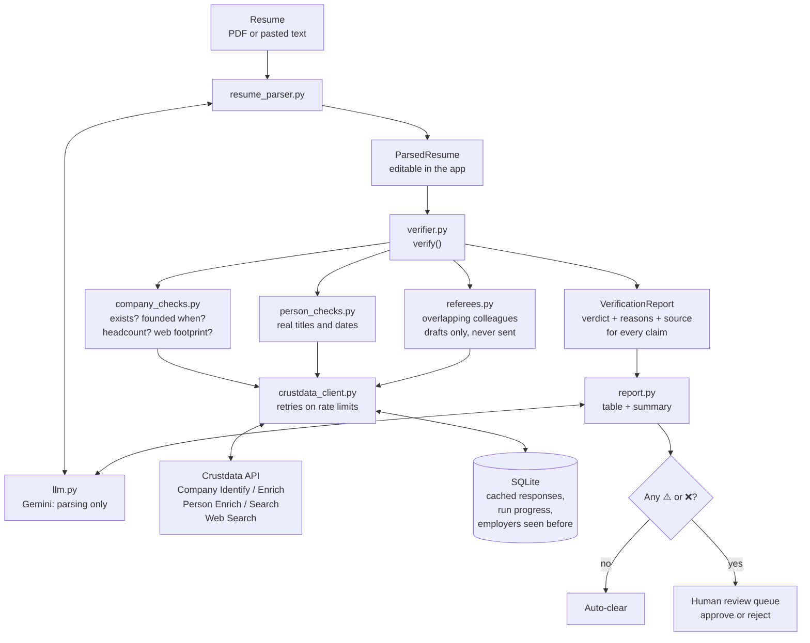

# Submission drafts: background-verification agent

Anything in [square brackets] needs a real detail from Himanshu or from your test runs. Fill it in or delete it before submitting.

---

## 1. README sections

### The service and who pays for it today

Before an Indian company makes an offer, it pays a background-verification firm to confirm the candidate's past employment. HR and talent-acquisition teams at IT services firms, startups and enterprises pay per candidate. The work is manual: verifiers phone HR departments, email former employers and wait days for replies.

It is also easy to fool. "Experience mills" sell experience letters from companies that exist on paper but have never really operated. When the verifier calls the number on the letter, someone at the mill confirms the job.

### What it does now, and where it still needs a person

You upload a resume as a PDF or paste the text. The agent:

1. **Extracts every claim** with an LLM: employers, titles, start and end dates, team-size claims, employer websites, LinkedIn URL and education. A person can correct the extracted claims before verification starts.
2. **Checks each employer** with Crustdata Company Identify, Company Enrich and Web Search: does it exist, when was it founded, how many people work there, and does it have a footprint beyond its own website?
3. **Checks the person** with Crustdata Person Enrich or Person Search: do the claimed titles and dates match their real career history?
4. **Finds possible referees**: people who worked at the same company over the same period. It drafts a reference-check message for each and never sends it.
5. **Gives a verdict on every claim**, with reasons and a source:

   | Symbol | Verdict |
   | --- | --- |
   | ✅ | Verified |
   | ⚠️ | Discrepancy |
   | ❌ | Contradicted |
   | ❓ | Cannot verify |

6. **Acts or hands over.** A resume with no ⚠️ or ❌ is cleared automatically. Anything flagged goes to a human review queue, where a named reviewer approves or rejects it.

**Where it still needs a person:**

- every ⚠️ and ❌ goes to a reviewer, and the agent never rejects a candidate on its own;
- a ❓ means the data wasn't there, not that the claim is false, so a reviewer decides whether to chase it;
- referee messages are drafts only, so a person decides whether to send them;
- scanned PDFs with no text layer need the text pasted in.

### Approaches we weighed

**AI verdicts vs fixed rules.** We could have handed the resume and the Crustdata evidence to an LLM and asked it to judge. We chose fixed Python rules for every verdict instead, because:

- the same evidence always gives the same verdict, however the resume is worded;
- every verdict can state its exact reason, such as "company founded 2023, claimed start 2019";
- an LLM can be talked into things by text inside the resume.

The LLM does only two jobs: turning a messy resume into structured claims, and writing a 3–4 sentence summary of verdicts that are already decided. Its output is checked against the resume text, and any value it can't find there is removed.

**Training a model vs live lookups.** We didn't train anything. Employment facts change constantly, and the job needs fresh lookups with citable sources, not knowledge stored in a model.

**Accuse vs "cannot verify".** A job missing from a public profile proves nothing; profiles are often incomplete. So a missing record gives ❓, never ❌. A ❌ needs positive evidence, such as a founding date after the claimed start.

### What worked and what didn't

| What we tried | Result |
| --- | --- |
| Checking that each extracted value appears in the resume by stripping punctuation and looking for a substring | **Failed.** "MBA" matched inside "IIT Bombay", so an invented degree passed. A test caught it. |
| Matching whole words instead | **Worked.** "B.Tech" still matches "BTech", and "MBA" no longer matches "Bombay". |
| Gemini models | **Mixed.** [Describe the timeouts: which model, how often.] The model we started with, `gemini-2.5-flash`, is no longer available to new API keys, so we moved to `gemini-3.8-flash`. The model name is a setting, so switching took one line. |
| Falling back to a plain summary when the LLM fails | **Worked.** A Gemini failure can't block a report. |
| Finding referees with Person Search | **Rarely useful.** Searching past employees of a company works, but few results overlapped the candidate's dates by 6 months or more. [Add numbers, e.g. "1 overlapping colleague across 4 test resumes".] |
| Looking up a made-up employer in Company Identify by name | **Needed care.** Fuzzy matching returns lookalike companies at 0.6 confidence for any name, including real tiny firms with similar names. We match exactly first and accept a fuzzy match only if the names are very close. |

### The hardest case: the wrong "Zoho Belgium" match

[Confirm the details with Himanshu.] A candidate's "Zoho" job was matched by Crustdata to a small Zoho entity in Belgium instead of Zoho Corporation in India. The Belgian entity had a different founding year and a tiny headcount, so a genuine job at a large company came out as a discrepancy. That is the worst kind of error for this product: an honest candidate flagged.

[Describe the fix, for example:] We now prefer the company ID on the candidate's own profile when one exists, then the company's domain, and only then a name lookup. When several companies share a name, we pick the one in India or with the larger headcount, and say in the reasons which one we chose.

### What we left out, and what's next

Left out on purpose:

- **Sending anything.** The agent never contacts candidates, employers or referees.
- **Education verification** beyond comparing against the profile; there is no university-registry check.
- **Scanned PDFs.** There's no OCR yet.

Next:

1. More test resumes with known answers, to measure how many fakes we catch and how many honest candidates we wrongly flag.
2. OCR for scanned PDFs.
3. Better referee search, for example by team or location as well as company and dates.
4. Moving the review queue from a JSON file into the same SQLite store as the checks.
5. Checking company registration data, so a company that exists only on paper is easier to spot.

---

## 2. Mermaid diagram

Paste this into mermaid.live, then use **Share** (or **Actions → Copy link**) to get a link anyone can open.

---

## 3. Two-minute demo script

**0:00–0:15. The problem.**
"Before an Indian company makes an offer, it pays a verification firm that takes days and still gets fooled by experience mills selling letters from shell companies. Our agent does it in minutes, with a source for every verdict."

**0:15–0:50. The fake employer.**
Paste `samples/fake_employer.txt`. Show the extracted claims for a second, then click Verify.
"The resume claims a job at Nexora Infotech Solutions from [year]." Point at the ❌.
"Contradicted: [read the reason, e.g. no matching company and no web presence]. And here's the source." Click the source link.

**0:50–1:20. The team size.**
Paste `samples/team_size_tiny_company.txt` and click Verify.
"This candidate says they led a team of 15." Point at the ⚠️.
"Crustdata lists the company at [2–10] people. That's a discrepancy, not a rejection, so it goes to a human."

**1:20–1:45. The review queue.**
Open the Human review queue page.
"Only flagged cases land here. A reviewer sees the evidence, approves or rejects, and their decision is recorded. Clean resumes never reach this page."

**1:45–2:00. What's next.**
"Verdicts come from fixed rules, so the same evidence always gets the same answer. Next, we're measuring catch rate on a larger set of known-fake resumes."

---

## 4. Submission form text

**One-line description**

An agent that reads a candidate's resume and returns a source-cited background-verification report in minutes, catching fake employers and inflated claims, and sending only flagged cases to a human.

**How your product works**

You upload a resume or paste its text. An LLM extracts each claim (employer, title, dates, team size, education), and the app checks every extracted value against the original text so nothing is invented.

For each employer, the agent uses Crustdata Company Identify, Company Enrich and Web Search to check that the company exists, when it was founded, its headcount and its footprint on the web. For the candidate, it uses Person Enrich or Person Search to compare claimed titles and dates with their real career history, matching on Crustdata's company ID so renamed and acquired companies still match. It also finds former colleagues whose dates overlapped and drafts reference-check messages, which it never sends.

Every verdict (verified, discrepancy, contradicted or cannot verify) comes from fixed Python rules, not the LLM, so the same evidence always gives the same answer, and each one comes with its reason and source. Missing data gives "cannot verify", never an accusation. Crustdata responses are cached in SQLite, so a rerun costs nothing and a crashed run resumes where it stopped. Clean resumes are cleared automatically; anything flagged goes to a review queue where a person approves or rejects it.
