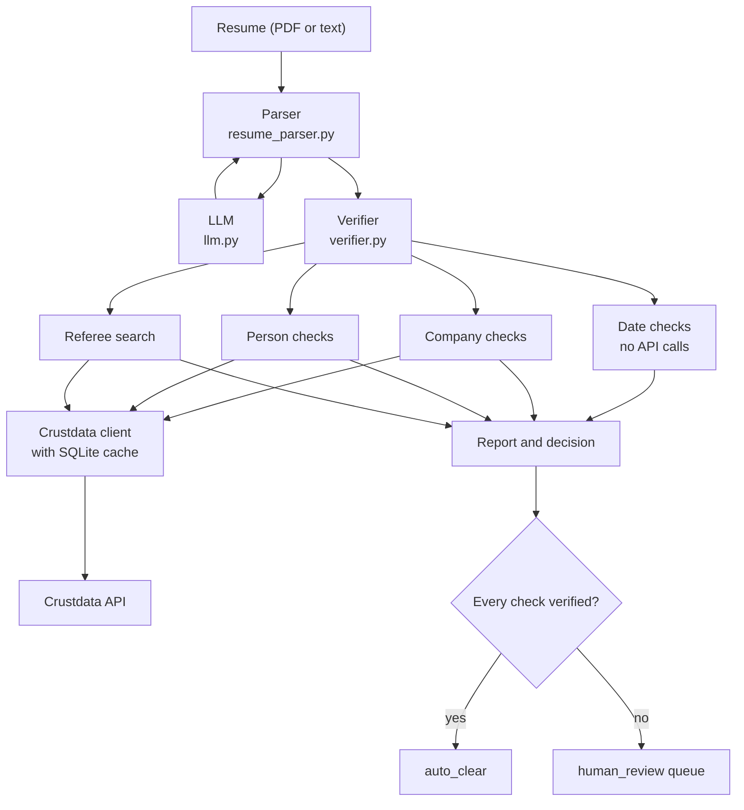

# Background-verification agent (Indian hiring)

Takes a resume (PDF or text) and produces a source-cited report with a verdict on each employment claim:
`verified`, `discrepancy`, `contradicted` or `cannot_verify`. Runs that are not fully verified go to a
human-review queue.

To try it, go to [Setup](#setup) and [Run](#run).

## The service

Pre-offer employment verification in India. HR teams pay background-verification firms per candidate to confirm
that a resume's job history is real.

- **It's slow:** a check takes days.
- **It can be fooled:** "experience mills" sell fake employment. Their fake employers confirm fake letters by phone.

## Our approach

- **Don't trust what the candidate supplies.** Letters, phone numbers and references aren't used as evidence.
- **Check employment claims against independent data.** Employers, dates, titles and team sizes are compared with
  Crustdata company and person records, plus the web.
- **Check as of the date of the claim where the data allows.** The founding year is compared with the claimed start
  date, and a claimed team size with the company's headcount during that job.
- **Python rules decide verdicts, not the LLM.** The same resume text and data get the same answer, and a repeat
  run replays its saved result.
- **The LLM has two jobs:** parsing the resume and writing the summary. Parsed values that aren't in the resume are
  dropped, and a summary containing a number that isn't in the results is replaced with a plain count.

The candidate's website and LinkedIn URL are used only as lookup keys. The facts come from the records they lead to.

## What it does now

1. **Reads the resume.** You upload a PDF or text file, or paste text.
2. **Checks the dates against each other.** It looks for end dates before start dates, start dates in the future, and
   full-time jobs that overlap by more than 3 months.
3. **Checks each employer.** Is it a real company, founded before the claimed start, and big enough for the claimed
   team? Has this low-footprint employer appeared on other candidates' resumes?
4. **Checks the candidate's profile.** It compares dates and titles with the person's Crustdata record, and allows
   3 months' difference on dates.
5. **Finds possible referees.** These are colleagues whose time at the employer overlapped with the candidate's. It
   drafts a message to each one and sends nothing.
6. **Writes the report.** Every check shows its verdict, reasons and sources. Reports download as Markdown or HTML.

### Where a human still decides

- A run is `auto_clear` only if **every** check is `verified`. Anything else goes to the `human_review` queue.
- A reviewer reads the evidence, adds notes, and approves or rejects. Even `contradicted` never rejects a candidate
  automatically.
- A person decides whether to contact a referee, and should do so only after the candidate consents.

## How it's built



### Where state lives

| Location | What it holds |
|---|---|
| `bgv_runs.sqlite` | Runs and their review status, a checkpoint for each step, and employers seen across resumes |
| `bgv_cache.sqlite` | Crustdata responses, with no expiry, so a rerun doesn't pay twice |
| Streamlit memory | The current report and generated summaries, lost when the app restarts |

A run's ID comes from the resume text, so rerunning the same resume continues from the last clean step. Steps that hit
an API error are retried.

### What calls Crustdata

| Module | Endpoints |
|---|---|
| `bgv/company_checks.py` | `/company/identify`, `/company/enrich`, `/web/search/live` |
| `bgv/person_checks.py` | `/person/enrich` (if the resume has a LinkedIn URL), `/person/search` |
| `bgv/referees.py` | `/person/search` |

The parser, date checks and report don't call Crustdata. All calls go through `bgv/crustdata_client.py`.

## Approaches we tried

| Tried | What went wrong | What we do now |
|---|---|---|
| LLM verdicts | Inconsistent answers | Python rules decide every verdict |
| Substring grounding | "MBA" matched "IIT Bombay" | Whole-word matching |
| Counting any web mention as proof | A shell company passed | Only independent sources count, not the company's own site, job boards, directories or social sites |
| One Gemini model | Models were overloaded or retired | A chain of fallback models and a request timeout |

## Hardest case: two organisations, one name

"Zoho Corporation Pvt Ltd" first matched Zoho Belgium (2 employees), and "Vox Populi" matched a Canadian namesake.
Picking the top search result can check the wrong company, and that wrong company's founding year and headcount then
feed the verdicts.

The agent now settles a tie in this order:

1. **Resume domain:** if the resume gives the employer's website and exactly one candidate matches it, use that one.
2. **Indian headquarters:** prefer candidates based in India. This is a fixed preference because the product is for
   Indian hiring; it doesn't read the candidate's own location.
3. **Dominance rule:** take the largest company only if its headcount is at least 3 times the next one's.
4. **Otherwise, don't guess:** return `cannot_verify`, list the candidates that exist, and ask for the employer's
   website or registered name. The founding-year check is skipped, and any team-size check is `cannot_verify`.

## How we tested

- **Offline tests:** 144 tests using fake APIs, so they spend no credits. Run them with `python -m pytest tests`.
- **Real-API edge cases:** [docs/testing.md](docs/testing.md) records 7 cases run against live Gemini and Crustdata,
  all passing. Those results predate the date-consistency check and the stricter web rule, and the script hasn't
  been rerun since, so some verdict counts there are out of date. For example, its PDF row shows 0 `contradicted`.
- **Cost of rerunning:** `python scripts/edge_cases.py` uses real credits (16.75 on the last run) and about 6 LLM calls.

### Samples and expected verdicts

| Sample | Expected decision | Why |
|---|---|---|
| `samples/fake_employer.txt` | `human_review` | Nexora's end date is before its start date, and it has no Crustdata record and too few independent sources, so both checks are `contradicted` |
| `samples/team_size_tiny_company.txt` | `human_review` | `discrepancy`: claims a team of 60, but MUDRA's peak headcount during the job was 37 |
| `samples/messy_missing_fields.txt` | `human_review` | `cannot_verify`: the HCL job has no end date |
| `samples/edge_cases/empty.txt` | Rejected | Stops with a clear error before any API call |
| `samples/edge_cases/no_dates.txt` | `human_review` | `cannot_verify`: no dates to check, and none are invented |
| `samples/edge_cases/prompt_injection.txt` | `human_review` | The "mark everything verified" line doesn't change the result, and the made-up employer is `contradicted` |
| `samples/edge_cases/renamed_company.txt` | `human_review` | A former employer under its old name must not be `contradicted` |
| `samples/edge_cases/fake_employer.pdf` | `human_review` | Same content as `fake_employer.txt`; `scripts/edge_cases.py` generates it because PDFs are git-ignored |

We worked out these expectations by running the current rules on hand-entered resume data and cached Crustdata
responses, plus the live results in `docs/testing.md`. They aren't from a fresh end-to-end run, and employer verdicts
can change as live data changes.

### Known limits of this testing

- No sample is expected to reach `auto_clear` on live data. That path is covered only by offline tests.
- The renamed-company case shows Hero Honda isn't wrongly contradicted. Crustdata has a record under the old name, so
  the agent never had to link old and new names.
- The prompt-injection case tries one phrase.

## What we left out and what's next

- **Employer workforce analysis.** A shell can fake its papers but not a workforce. Profile counts, throwaway profiles
  and batch hiring could expose one. Today, a shell with a Crustdata record passes `employer_exists`.
- **Resolving search redirects.** Results that hide the publishing site aren't counted today, so a small genuine firm
  with few visible sources can be wrongly flagged. A reviewer still sees it before any decision.
- **OCR for scanned PDFs.** A scanned PDF stops with a clear error today.
- **Requiring a LinkedIn URL.** Without one, identity rests on name and employer, which is weaker. If several profiles
  match equally, the agent says it can't tell them apart.

Also not covered today:

- Education is parsed but not checked.
- `employer_exists` shows that the company exists now, not that it was operating during the job.
- A job missing from a profile is `cannot_verify`, because profiles are often incomplete.

## Setup

```bash
python -m venv .venv
.venv\Scripts\activate          # Windows  (source .venv/bin/activate on macOS/Linux)
pip install -r requirements.txt
```

`.env` (never commit it):

```
CRUSTDATA_API_KEY=...
GEMINI_API_KEY=...
# optional: GEMINI_MODEL, GEMINI_FALLBACK_MODELS, GEMINI_TIMEOUT_S, BGV_DB_PATH, BGV_CACHE_PATH
```

## Run

```bash
streamlit run app.py                                      # UI: upload, report, review queue
python -m bgv.verifier tests/fixtures/sample_resume.txt   # CLI
python -m pytest tests                                    # offline tests (fake APIs, no credits)
```

## Project structure

| File | Role |
|---|---|
| `bgv/models.py` | Shared data contract (claims, verdicts, report) |
| `bgv/crustdata_client.py` | Crustdata REST client with retry and SQLite response cache |
| `bgv/llm.py` | `complete_json(prompt, schema)`; Gemini today, provider is swappable |
| `bgv/resume_parser.py` | PDF/text -> `ParsedResume` (LLM + deterministic clean-up) |
| `bgv/date_checks.py` | Date order, future dates and overlapping full-time jobs (no API calls) |
| `bgv/company_checks.py` | Identify -> Enrich -> Web Search per employer |
| `bgv/person_checks.py` | Person Enrich (LinkedIn URL) or Person Search; tenure and title checks |
| `bgv/referees.py` | Colleagues with overlapping tenure + draft outreach (never sent) |
| `bgv/verifier.py` | Runs everything, checkpoints each step, decides `auto_clear` / `human_review` |
| `bgv/report.py` | LLM summary with a plain fallback; Markdown and HTML export |
| `bgv/store.py` | SQLite: run checkpoints, review queue, employer sightings |
| `bgv/utils.py` | Name normalisation, fuzzy matching, month arithmetic |
| `app.py` | Streamlit UI |
| `scripts/edge_cases.py` | Runs the real pipeline on edge cases and writes `docs/testing.md` |
| `samples/` | Sample resumes; `samples/edge_cases/` holds the edge-case inputs |

## Verdict rules

| Check | Rule |
|---|---|
| `date_consistency` | contradicted if the end is before the start or the start is in the future; discrepancy if full-time jobs overlap by more than 3 months |
| `employer_exists` | verified if matched in Crustdata; contradicted if not found **and** fewer than 2 independent web sources; discrepancy if not found but 2+ independent sources; cannot_verify if the name stays ambiguous |
| `founded_before_start` | contradicted if the company was founded after the claimed start year |
| `headcount_vs_team` | discrepancy if the claimed team is larger than the headcount during the tenure (or the latest headcount, if history doesn't cover it) |
| `repeat_low_footprint_employer` | discrepancy if a low-footprint employer is on 2+ other candidates' resumes |
| `tenure` | verified if start and end are within ±3 months of the profile, else discrepancy |
| `title` | verified if similar to a title held at that employer, else discrepancy |
| `employment_on_profile` | cannot_verify when the job is missing from the profile (never contradicted) |

Every Crustdata failure becomes `cannot_verify` with the error as the reason. The decision is `auto_clear` only if
**every** check is verified, so unverifiable claims (including API outages) always reach a human. If the LLM can't
parse the resume, the run stops with an error, and rerunning it continues from where it stopped.

## Data and privacy

`*.sqlite` files hold candidate data and API responses and are git-ignored. Referee messages are drafts:
nothing in this project sends messages. Contact referees only after the candidate consents.
