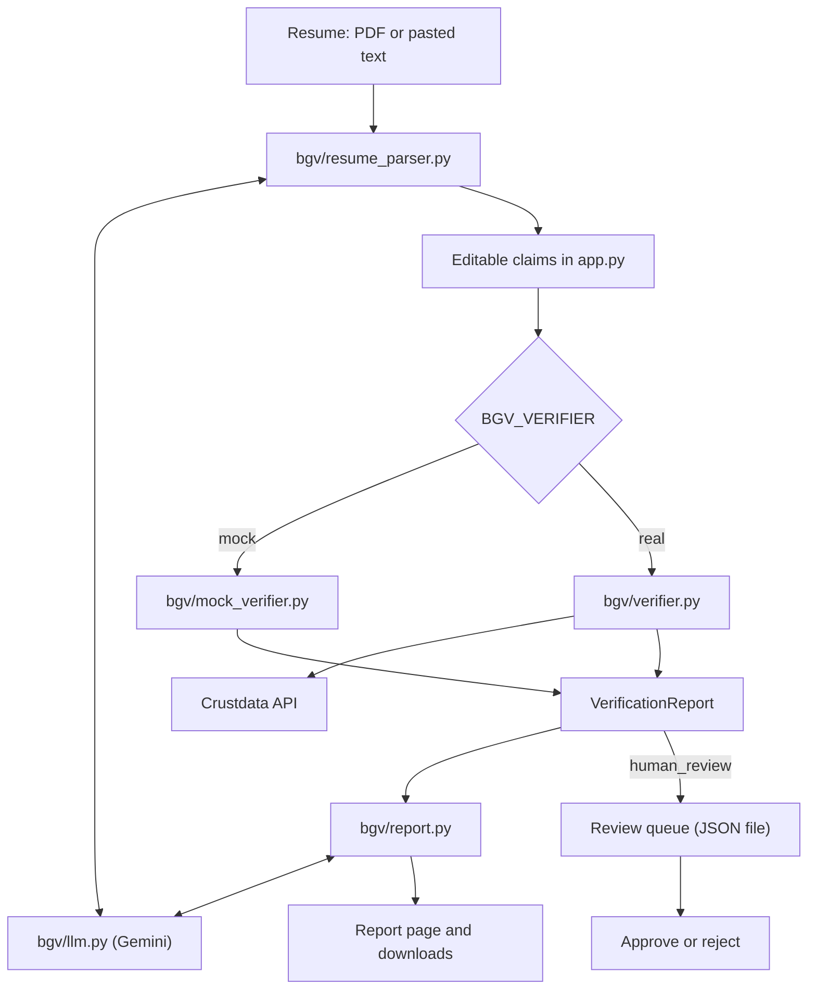

# Background Verification Agent

An agent that checks the employment claims on a resume for hiring in India, shows the evidence for each result, and sends anything doubtful to a human reviewer.

> **Status:** the UI, parser and report are built, but the verification backend isn't connected yet. The app runs on a mock verifier by default, so **every verdict it shows is made up**. Live LLM calls haven't been run yet either.

## The service and who pays for it today

Employers in India check candidates' claims before making or confirming a hire, and they pay for it. They either run the checks in-house, with HR teams contacting past employers, or pay a background verification vendor per candidate. This agent automates the first pass on employment claims, so people spend their time on the cases that need judgment.

## What it does now

1. Takes a resume as an uploaded PDF or pasted text.
2. Extracts the jobs, dates, titles, team-size claims, employer domains, LinkedIn URL and education. Anything the resume doesn't state stays empty.
3. Lets a person correct those claims before verification.
4. Runs a verifier and shows one row per check, with a verdict, reasons and clickable sources:

   | Symbol | Verdict |
   | --- | --- |
   | ✅ | Verified |
   | ⚠️ | Discrepancy |
   | ❌ | Contradicted |
   | ❓ | Cannot verify |

5. Lists suggested referees with draft messages, labelled "Draft — not sent". The app never sends anything.
6. Adds a 3–4 sentence summary and a decision: `auto_clear` or `human_review`.
7. Puts `human_review` runs in a queue where a named reviewer approves or rejects them. Each decision is recorded once and can't be overwritten.
8. Lets you download any report as Markdown or HTML.

The LLM is used only to parse resumes and write the summary. It never decides a verdict.

## How to run it

Requires Python 3.14, the only version this has been tested on.

```bash
python3 -m venv .venv
source .venv/bin/activate
pip install google-genai pydantic python-dotenv pypdf streamlit pytest pandas requests
```

Create a `.env` file in the repo root. It's gitignored, so never commit it.

```bash
GEMINI_API_KEY=your-key-here
```

Then start the app:

```bash
streamlit run app.py
```

Run the tests from the repo root:

```bash
python -m pytest tests
```

Tests in `tests/test_parser_live.py` call Gemini, so they skip until `GEMINI_API_KEY` is set. All the others run offline.

### Settings

| Variable | Default | Purpose |
| --- | --- | --- |
| `GEMINI_API_KEY` | None | Required for parsing. Without it, summaries fall back to a plain count of the verdicts. |
| `GEMINI_MODEL` | `gemini-2.5-flash` | The Gemini model to use. |
| `BGV_VERIFIER` | `mock` | `mock` uses `bgv/mock_verifier.py`. `real` uses `bgv/verifier.py`. |
| `BGV_REVIEW_FILE` | `~/.bgv/review_queue.json` | Where review runs and decisions are stored. The default is outside the repo because the file holds candidate data. |

### Sample resumes

| File | What it tests |
| --- | --- |
| `samples/fake_employer.txt` | An employer that doesn't exist, and an end date before the start date |
| `samples/team_size_tiny_company.txt` | A team of 15 claimed at a real company listed with 2–10 staff |
| `samples/messy_missing_fields.txt` | Pasted tables, mixed date formats and missing fields |

The candidates are fictional. The samples leave out LinkedIn URLs because a made-up one could resolve to a real person. A clean sample based on a real public profile is still to come.

## How it's built



| File | Role |
| --- | --- |
| `bgv/models.py` | The shared data contract between the parser and the verifier |
| `bgv/llm.py` | `complete_json()`, the only code that knows about Gemini |
| `bgv/resume_parser.py` | `parse_resume()`: extracts PDF text, calls the LLM, and checks the answer against the resume |
| `bgv/verifier.py` | `verify()`: the real backend (in progress) |
| `bgv/mock_verifier.py` | A stand-in for `verify()` with the same signature |
| `bgv/report.py` | Renders Markdown and HTML, and writes the summary |
| `app.py` | The Streamlit UI and the review queue storage |

Three decisions shape the design:

- **Code decides, not the LLM.** Verdicts come from the verifier. The summary prompt only gets the existing verdicts, and the report keeps the original checks and decision whatever the LLM returns.
- **LLM output is checked, not trusted.** A false value in a claim would be checked as if the candidate had said it, so the parser removes any value it can't find in the resume text.
- **Resume text is treated as untrusted.** The prompts mark it as data, and the report escapes it. Only `http(s)` sources become links.

### Known limits

- A year with no month, such as "2016", is stored as `None`, because `YYYY-MM` can't hold it and guessing a month would invent data. The original line stays in `raw_text`.
- `bgv/models.py` requires `full_name`, `employer` and `title` as strings, so a missing one is `""`, not `None`.
- The team-size check accepts any positive number, so that "a dozen" can still count. It doesn't confirm the number is in the resume.
- The summary check catches invented numbers but not invented words. The prompt is the only defence against those.
- Scanned PDFs have no text layer and aren't supported, so the app asks for pasted text instead.

## Approaches we tried and what worked

| Approach | Result |
| --- | --- |
| Checking values against the resume by removing punctuation and looking for a substring | **Failed.** "MBA" matched inside "IIT Bombay", so an invented degree passed. A test caught it. |
| Matching whole words, ignoring punctuation | **Worked in offline tests.** "B.Tech" matches "BTech", and "MBA" no longer matches "Bombay". |
| Falling back to a plain summary when the LLM fails | **Worked in offline tests.** A Gemini failure can't block a report. |
| Looking up the fake employer in Crustdata by name | **Mixed.** An exact match correctly finds nothing, but fuzzy matching returns lookalike companies at 0.6 confidence. |

Parsing quality against real Gemini responses is still untested.

## What we'd do next

1. Run the live parser tests with a Gemini key, and fix what they find.
2. Connect `bgv/verifier.py` and test all the samples end to end with `BGV_VERIFIER=real`.
3. Add the clean sample based on a real public profile.
4. Decide with the backend owner whether review runs should move from the JSON file to `store.py`.
5. Decide whether `full_name`, `employer` and `title` should become optional in `bgv/models.py`.
6. Add OCR for scanned PDFs.
